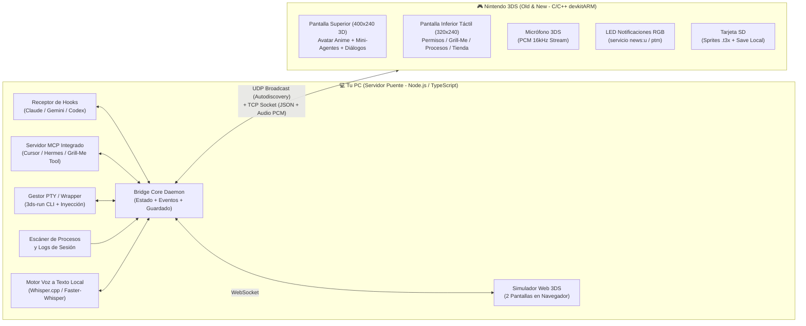
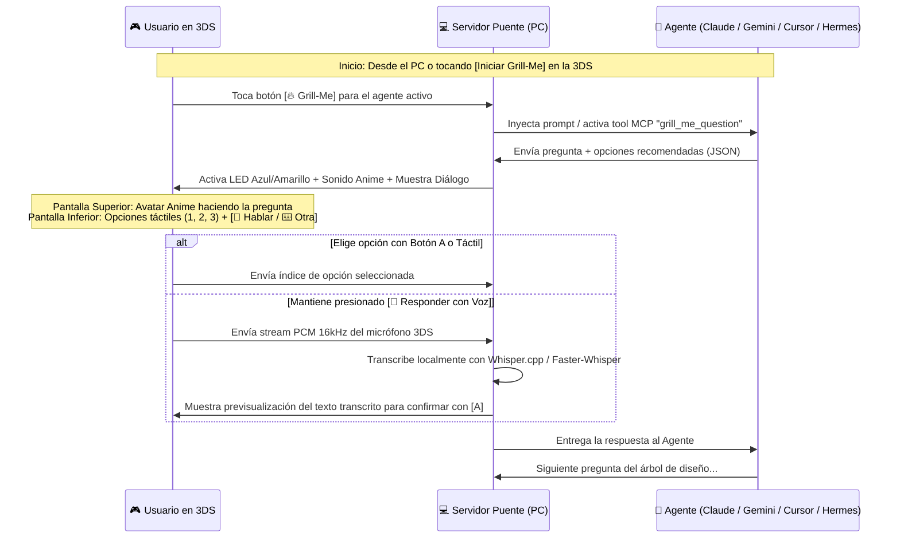

# 🎮 Proyecto: 3DS Agent Companion ("AgentGotchi 3DS")
**Documento de Arquitectura y Plan de Implementación**

---

## 1. Visión General del Proyecto
Una aplicación homebrew nativa para **todas las consolas de la familia Nintendo 3DS** (Old 3DS, Old 3DS XL, Old 2DS, New 3DS, New 3DS XL, New 2DS XL) acompañada de un **Servidor Puente en PC** y un **Simulador Web Dual-Screen**.

Su propósito es convertir tu Nintendo 3DS en un **compañero de escritorio estilo Anime/Manga (inspirado en Hermes Agent / Visual Novels)** que monitorea, organiza y controla a tus agentes de IA (**Claude Code, Gemini CLI / Antigravity, Codex, Cursor y Hermes Agent**), permitiéndote:
1. **Aprobar o rechazar permisos** en tiempo real con los botones físicos (`A` / `B`).
2. **Realizar sesiones de entrevista interactiva (`/grill-me`)** estilo RPG/Visual Novel desde las dos pantallas de la 3DS (usando botones, pantalla táctil o voz por micrófono).
3. **Visualizar el estado y modelos activos** de cada agente mediante tu personaje principal y mini-ayudantes flotantes.
4. **Progresar en un sistema de mascota virtual RPG** (XP, niveles, café/energía, monedas "Tokens" y tienda de personajes masculinos/femeninos, trajes y habitaciones).

---

## 2. Arquitectura del Sistema



> [!IMPORTANT]
> **Compatibilidad universal (Old 3DS vs New 3DS):**
> Al usar **TCP puro sobre LAN + JSON compacto** en lugar de TLS 1.3 pesado, y gráficos vectoriales/sprites empaquetados con `tex3ds` sobre la GPU PICA200 (`citro2d`), la aplicación consumirá menos de **15 MB de RAM** y correrá a **60 FPS constantes** incluso en la Nintendo 3DS original de 2011 y Nintendo 2DS.

---

## 3. Cómo se Conectan los Agentes (Los 4 Pilares + Modo `/grill-me`)

### 3.1. Los 4 canales de integración en el Servidor Puente
| Canal | Agentes que cubre | Qué permite hacer desde la 3DS |
| :--- | :--- | :--- |
| **1. Hooks Nativos (`PreToolUse`, `Stop`, `Notification`)** | Claude Code, Gemini CLI / Antigravity, Codex CLI | Intercepta cualquier comando o edición que pida permiso. El script del hook pausa al agente hasta que presionas `A` (Permitir) o `B` (Denegar) en la 3DS. |
| **2. Servidor MCP Nativo (`3ds-companion-mcp`)** | Cursor, Hermes Agent, Claude Desktop, Antigravity | Expone herramientas MCP: `grill_me_question`, `request_3ds_approval`, `set_agent_mood`. Cualquier agente con MCP puede hablarte directo a la 3DS. |
| **3. Wrapper de Terminal (`3ds-run <comando>`)** | Cualquier CLI (Claude, Gemini, Hermes, Aider, scripts) | Ejecuta el agente dentro de un pseudo-terminal (`node-pty`). Permite ver las últimas líneas de consola en la 3DS e **inyectar respuestas, comandos o dictado por voz** directamente al `stdin` del agente. |
| **4. Escáner Pasivo de Procesos y Sesiones** | Todos (incluso abiertos fuera del wrapper) | Cada 2 segundos detecta procesos vivos y lee metadatos locales (ej. `~/.claude/`, carpetas de sesión de Gemini/Hermes/Cursor) para mostrar qué modelo exacto está activo (`claude-sonnet-4`, `gemini-2.5-pro`, etc.). |

### 3.2. Flujo del Modo `/grill-me` Universal en la 3DS
Como utilizas mucho `/grill-me`, será un **ciudadano de primera clase** en la arquitectura:



---

## 4. Diseño de Interfaz Dual-Screen y Estética Anime/Manga

### 4.1. Pantalla Superior (400 × 240 px — Con soporte 3D estereoscópico)
Diseñada como una escena de **Visual Novel / JRPG moderno (estilo Hermes)**:
* **Capas con Profundidad 3D (Slider 3D de la consola):**
  1. **Fondo (Profundidad -2):** Habitación / estudio de programación estilo anime (cambia según la hora del día o el fondo comprado en la tienda).
  2. **Plano Medio (Profundidad 0):** Tu **Compañero/a Anime principal** (puedes elegir entre avatares masculinos y femeninos estilo manga) en su escritorio.
  3. **Primer Plano Flotante (Profundidad +1):** **Mini-Espíritus / Drones por cada agente activo** orbitando alrededor del escritorio:
     * 🟠 **Claude:** Orbe/Mecha cálido terracota con indicador del modelo (Opus / Sonnet / Haiku).
     * 🔵 **Gemini:** Cristal estelar azul/violeta brillante.
     * ⚡ **Cursor:** Dron geométrico estilo IDE.
     * 🪽 **Hermes:** Emblema/mensajero alado estilo manga.
     * 🟢 **Codex:** Cubo de matriz verde terminal.
  4. **Capa HUD y Caja de Diálogo (Profundidad +2):**
     * Barra superior con: Nivel del compañero, barra de XP, Energía (☕ Café), Monedas (`🪙 Tokens`) y estado Wi-Fi.
     * Cuando hay un permiso o una pregunta de `/grill-me`, aparece un **retrato grande expresivo (Bust-up Portrait)** del personaje anime en un lateral con la caja de diálogo y el texto de la pregunta.

### 4.2. Estados de Ánimo (Expresiones del Avatar Anime)
| Estado de los Agentes | Expresión / Animación del Avatar Anime | Color LED 3DS |
| :--- | :--- | :--- |
| **Sin agentes activos (`Idle`)** | Relajado tomando café, leyendo un manga o cabeceando. | Apagado |
| **Agente pensando / codificando (`Working`)** | Concentrado, gafas reflejando código, tecleando rápido. | Pulso suave Azul |
| **Modo `/grill-me` esperando tu respuesta** | Mirando hacia la pantalla con libreta/holograma en mano y signo `?`. | Parpadeo Cian |
| **Permiso requerido (`Permission Pending`)** | Expresión de alerta (`!`) señalando la pantalla táctil. | Parpadeo Amarillo |
| **Tarea terminada / Build exitoso (`Success`)** | Sonrisa radiante / pose de victoria (`+XP`, `+Tokens`). | Destello Verde |
| **Error en comando o test fallido (`Error`)** | Expresión de susto / sudor estilo anime tratando de apagar un fuego. | Parpadeo Rojo |

### 4.3. Pantalla Inferior Táctil (320 × 240 px — Centro de Control)
Navegable tocando pestañas en la parte inferior o con los gatillos **`L` y `R`**:

1. **🔔 Pestaña 1: Interacción (`Inbox & Grill-Me`)** *(Se abre automáticamente cuando un agente te necesita)*
   * **En modo Permiso:** Muestra qué agente y modelo lo pide, el comando o archivo afectado, y dos botones gigantes: `[ (A) APROBAR ]` y `[ (B) RECHAZAR ]`.
   * **En modo `/grill-me`:** Lista de tarjetas táctiles con las opciones propuestas por el agente (con la opción `(Recommended)` destacada arriba), más los botones `[ 🎤 Dictar respuesta (Mantener R o Tocar) ]` y `[ ⌨️ Teclado ]`.
2. **🤖 Pestaña 2: Agentes y Procesos (`Squad`)**
   * Lista de todos los agentes detectados (Claude, Gemini, Cursor, Hermes, Codex), mostrando: **Nombre del proyecto**, **Modelo activo**, **Estado** y **Tiempo activo**.
   * Al tocar un agente: ves sus últimas líneas de consola en vivo y un botón directo **`[ 🔥 Lanzar /grill-me en este agente ]`** o **`[ ⚡ Enviar instrucción rápida ]`**.
3. **🎙️ Pestaña 3: Comandos Rápidos y Voz (`Deck`)**
   * Botones configurables tipo Stream Deck: `[Continuar]`, `[Correr Tests]`, `[Git Status / Diff]`, `[Resumir cambios]`, `[Cancelar / Ctrl+C]`.
   * **Botón central Walkie-Talkie:** Mantén pulsado con el stylus para hablarle al agente seleccionado mediante Whisper local.
4. **🏠 Pestaña 4: Compañero y Tienda (`Character & Shop`)**
   * **Cambiar de Personaje:** Selector entre los avatares masculinos y femeninos estilo anime/manga.
   * **Dar Café / Descanso:** Rellena la barra de energía/ánimo (sistema amigable: nunca muere ni pierde niveles si descansas el fin de semana).
   * **Tienda de Tokens:** Gasta las monedas ganadas trabajando para desbloquear nuevos personajes, atuendos, accesorios y temas de habitación.

---

## 5. Especificación del Protocolo de Red y Hardware 3DS

### 5.1. Autodescubrimiento y Transporte
* **Autodescubrimiento (UDP Puerto `33333`):** El Servidor Puente emite un beacon UDP en la LAN cada 3 segundos (`{"service":"3ds-agent-companion","port":33334,"pcName":"Mi-PC"}`). La 3DS lo detecta al instante al abrir la app sin que tengas que escribir la IP (con opción de IP manual en un archivo `config.ini` en la SD como respaldo).
* **Canal Principal (TCP Puerto `33334`):** Mensajes JSON delimitados por salto de línea (`NDJSON`). Es ultra rápido de parsear en C con `cJSON` y consume mínima CPU en la 3DS.
* **Stream de Micrófono:** Cuando mantienes presionado el botón de hablar en la 3DS, el servicio `mic:u` de `libctru` captura audio **PCM mono de 16-bit a 16 kHz** (el formato exacto que pide Whisper) y lo envía en paquetes binarios/base64 por el socket TCP hacia el PC.

### 5.2. Uso de Hardware Nativo de la 3DS (`libctru`)
* **LED de Notificaciones RGB (`news:u` / `ptmSysm`):** Patrones de parpadeo suaves en el LED físico de la bisagra derecha para que veas si un agente terminó o te hace una pregunta de `/grill-me` incluso si estás mirando tu monitor.
* **Guardado Híbrido (SD + PC):** El progreso de tu mascota (`save.json`: nivel, XP, tokens, personaje activo, desbloqueables) se guarda en `sdmc:/3ds/AgentCompanion/save.json` y se sincroniza automáticamente con el Servidor Puente en tu PC para no perder nada.

---

## 6. Estructura del Repositorio

Proponemos organizar el proyecto como un **Monorepo limpio** dentro de tu carpeta de proyectos:

```text
3ds-agent-companion/
├── bridge-server/              # 💻 Servidor Puente en Node.js + TypeScript
│   ├── src/
│   │   ├── index.ts            # Entrada principal (TCP Server + WebSocket + UDP Discovery)
│   │   ├── state/              # Estado de agentes, cola de permisos/grill-me y Save de mascota
│   │   ├── adapters/
│   │   │   ├── mcp-server.ts   # Servidor MCP (expone grill_me_question, ask_3ds, etc.)
│   │   │   ├── hooks-api.ts    # Endpoint local para hooks de Claude Code / Gemini / Codex
│   │   │   ├── pty-manager.ts  # Wrapper CLI (3ds-run) para gestionar procesos e inyectar texto
│   │   │   └── scanner.ts      # Detector de procesos y modelos activos (Cursor, Hermes, etc.)
│   │   └── voice/
│   │       └── whisper-local.ts# Integración con Whisper.cpp / Faster-Whisper para el mic de 3DS
│   └── hooks-scripts/          # Scripts listos para instalar en Claude/Gemini/Codex
│
├── web-simulator/              # 🌐 Simulador Dual-Screen idéntico a la 3DS (HTML5/Canvas/TS)
│   ├── index.html              # Carcasa interactiva de Nintendo 3DS con botones A/B/X/Y/L/R y Stylus
│   └── src/                    # Renderizador de las 2 pantallas, avatares anime, sonidos y mic web
│
├── nintendo-3ds-client/        # 🎮 App Nativa para Nintendo 3DS (C / C++ con devkitARM)
│   ├── Makefile                # Compila a .3dsx (Homebrew Launcher) y .cia (Menú HOME)
│   ├── source/
│   │   ├── main.c              # Loop principal a 60 FPS (citro2d + libctru)
│   │   ├── net_client.c        # UDP Autodiscovery + TCP Socket no bloqueante + cJSON
│   │   ├── top_screen.c        # Renderizado de habitación 3D, Avatar Anime, Drones y Diálogos
│   │   ├── bottom_screen.c     # UI táctil: Pestañas, Grill-Me, Permisos, Procesos y Tienda
│   │   ├── mic_streamer.c      # Captura de micrófono 3DS (mic:u 16kHz) y envío al PC
│   │   └── hardware_fx.c       # Control de LED RGB, audio NDSP y guardado en SD
│   └── gfx/                    # Spritesheets (.t3s) de los personajes anime, iconos y UI
│
└── docs/
    └── protocol-spec.md        # Especificación completa de mensajes JSON PC <-> 3DS
```

---

## 7. Plan de Implementación por Fases

### 🚀 Fase 1: Núcleo del Servidor Puente + Protocolo + Simulador Web 3DS
* Crear el proyecto en `bridge-server` y `web-simulator`.
* Implementar el estado central de la mascota (XP, Tokens, Personajes Masculino/Femenino estilo Anime) y el protocolo de mensajes.
* Construir el **Simulador Web de Nintendo 3DS** (con las dos pantallas exactas de 400×240 y 320×240, botones físicos interactivos y las 4 pestañas táctiles) para poder probar todas las pantallas, expresiones anime y flujos al instante en tu PC.

### 🔌 Fase 2: Integración Real con Agentes + Modo `/grill-me` + Voz Local
* Crear el **Servidor MCP** (`grill_me_question`, `request_permission`, `report_status`) para conectarlo a Cursor, Hermes, Claude y Antigravity/Gemini.
* Crear los **Scripts de Hooks** para Claude Code y Gemini CLI, más el comando wrapper `3ds-run` y el escáner de procesos.
* Integrar la transcripción de voz local (Whisper) para que puedas responder preguntas de `/grill-me` hablando.

### 🎮 Fase 3: Cliente Nativo en C/C++ para Nintendo 3DS (`devkitARM` + `citro2d`)
* Escribir el cliente nativo en `nintendo-3ds-client/` con autodescubrimiento UDP y cliente TCP JSON.
* Programar el renderizador de la pantalla superior (efecto 3D estereoscópico, retratos anime expresivos y mini-ayudantes de Claude/Gemini/Hermes/Cursor/Codex) y la interfaz táctil inferior.
* Conectar el micrófono nativo (`mic:u`), el LED de notificaciones RGB y el guardado en la tarjeta SD.

### 🎨 Fase 4: Arte Anime/Manga, Sonidos y Empaquetado (`.3dsx` / `.cia`)
* Generar y empaquetar el set inicial de avatares estilo anime/manga (chicos y chicas con sus variantes de expresión: *Idle, Working, Grill-Me, Alert, Happy, Error*) y los sprites de los mini-agentes en formato `.t3x`.
* Preparar el instalador automático de hooks/MCP en PC y la guía para cargar el `.3dsx` por `3dslink` (Wi-Fi directo a la consola) o tarjeta SD.

---

## 8. Próximo Paso
Revisa este documento de arquitectura. Si todo te parece bien (o si quieres ajustar algún detalle del diseño, de los personajes anime o del modo `/grill-me`), dale a **Proceed** o dime qué cambios quieres hacer para empezar a construir la **Fase 1 y 2** en tu directorio de trabajo.
